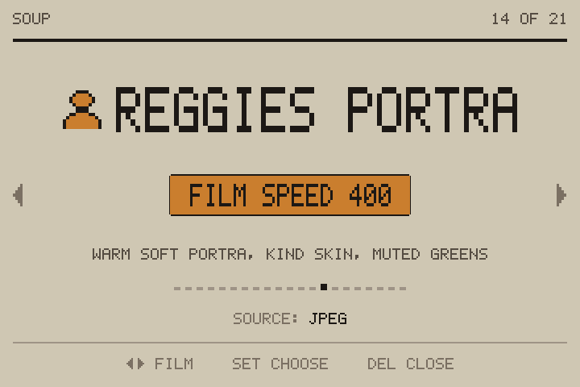
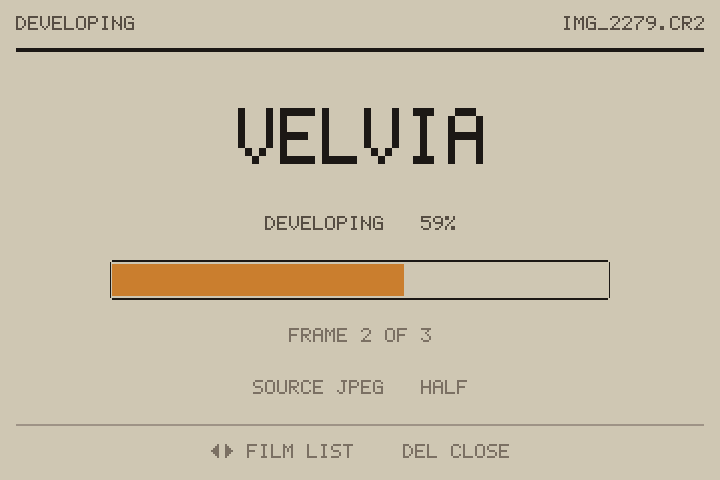
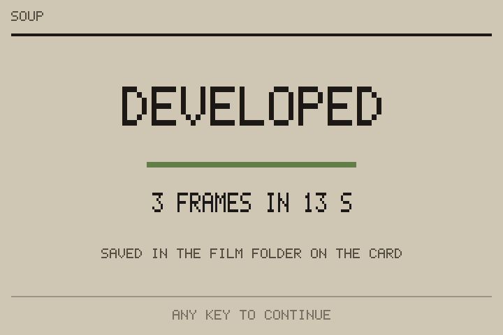

<div align="center">

# 🎞️ Soup Engine for the Canon EOS 60D <sub><sup>beta</sup></sub>

### Film looks, in the camera, on a Canon EOS 60D.

<br>



<br>
<br>

`beta` &nbsp;·&nbsp; `GPL v2` &nbsp;·&nbsp; `21 film stocks` &nbsp;·&nbsp; `EOS 60D` &nbsp;·&nbsp; `firmware 1.1.1`

</div>

<br>

A port of [**Soup Engine**](https://github.com/jiijii0/soup-engine) by
jiijii0 to the Canon EOS 60D. Press **SET**, pick a film, shoot.

> 📬 **Also offered to the original project.** The same port, laid out the
> way Soup Engine now organises cameras (one folder per body), is on this
> fork's [`canon-eos-60d`](https://github.com/kookueh/Soup-Canon-60D-Port/tree/canon-eos-60d/Canon-EOS-60D)
> branch and has been submitted to jiijii0/soup-engine as a pull request.
> Its card files also include `ML/SETTINGS/soup.en`, so the module loads
> without the Modules-tab step below. Every
photo you take while Film is on gets a second JPEG with the look already
on it, made in the camera shortly after the shot.

```
DCIM/100CANON/IMG_1234.CR2    your photo (RAW or JPEG), untouched
FILM/100CANON/FLM_1234.JPG    the same photo with the look on it
```

> ⚠️ **Beta.** Unofficial code on a sixteen year old camera. It's easy to
> remove. Supported firmware is **60D 1.1.1** only.

> ⚖️ **No warranty.** Like all GPL software this comes with none. You
> install it at your own risk. See sections 11 and 12 of the
> [licence](LICENSE).

> 🎨 **The looks are still being tweaked.** The names are shorthand for
> the films and recipes they're based on, not exact copies. All
> trademarks belong to their owners.

<br>

---

<br>

## ✨ What this port adds

The look engine, the film stocks and the picker design are Soup Engine's.
For the 60D this fork adds:

- **A Magic Lantern module.** It runs as `soup.mo` next to the official
  Magic Lantern 60D build, instead of a rebuilt `AUTOEXEC.BIN`.
- **The Soup Engine picker on the 60D**, opened with SET, with the
  original's **DEVELOPING** and **DEVELOPED** pages.
- **A small progress badge** on the shooting screen while frames develop.
- **A playback toggle.** In playback, SET swaps the photo on screen for
  its film version, and SET again brings back the original.
- **8 Fuji X Weekly recipes** as new stocks, and a translator
  (`src/tools/recipe2fs.py`) that turns a Fujifilm recipe into a stock.
- **RAW, RAW+JPEG and JPEG-only.** The film file keeps the shot's date,
  shutter, aperture and ISO, and records the stock in EXIF *Software*.
- **Only shots taken while Film is on are developed.** Photos already on
  the card are left alone.
- **Film files live outside DCIM**, so Canon's playback is never confused
  by them.

<br>

## 📦 Installing

#### 1️⃣ &nbsp; Install Magic Lantern

Install the official Magic Lantern build for the 60D first, following
their instructions:

> ### 👉 [builds.magiclantern.fm/60D.html](https://builds.magiclantern.fm/60D.html)

This port is built and checked against
`magiclantern.2025-06-20.60D.111`. The camera must be on firmware 1.1.1.

#### 2️⃣ &nbsp; Download the module

From this fork's
[**Releases**](https://github.com/kookueh/Soup-Canon-60D-Port/releases)
page, download the latest `soup-engine-60d-…zip` and unzip it.

#### 3️⃣ &nbsp; Copy the files to the card

Camera off, card in your computer. From the zip's `card/` folder, copy
onto the card, merging with the `ML` folder Magic Lantern put there:

```
ML/modules/soup.mo
ML/FILM/            INDEX.TXT and 21 .fs stocks
```

#### 4️⃣ &nbsp; Turn the module on

Card back in, camera on. Press the **trash button** to open Magic
Lantern, go to the **Modules** tab, select **soup**, press **SET** to mark
it for loading, then switch the camera off and on again.

#### ✅ &nbsp; Check it

Press **SET** on the shooting screen. The film picker should fill the
back screen. Pick a film with the wheel and press **SET**.

<br>

## 📷 Using it

### Picking a film

| Where | Button | What it does |
| --- | --- | --- |
| Shooting screen | **SET** | open the film picker |
| Picker | **wheel** or **◀ ▶** | browse the films |
| Picker | **SET** | choose this film (also turns Film on) |
| Picker | **Trash** or **MENU** | close |

The same settings are in the Magic Lantern menu under **Shoot → Soup
Film**: Film on/off, Stock, and a Status line.

> 💡 Most recipe looks are meant to be shot **+1/3 to +1 stop over**.

### While it develops

Developing takes a little while per frame. A small badge sits at the top right of
the shooting screen, with **+2** meaning two more frames are waiting, then
**FILM DONE** (or **FILM FAILED**) for a moment.


Press **SET** while a frame is developing to see the **DEVELOPING** page.
Turn the wheel there to go to the film list and pick the next stock. When
the queue finishes with the picker open, **DEVELOPED** shows how many
frames were done and how long it took.

<p>


</p>

### Seeing the look on the camera

Press **Play**. Once the photo is on screen, press **SET**: Soup swaps it
for its film version and shows **FILM &nbsp; SET: ORIGINAL** at the bottom.
Press **SET** again for Canon's original. Any other button puts the
original back first, then does what it normally does.

| Message | Meaning |
| --- | --- |
| `FILM: NO FILM VERSION OF THIS PHOTO` | taken with Film off, or before Soup was installed |
| `FILM: STILL DEVELOPING` | try again in a moment |
| `FILM: CAN'T TELL WHICH PHOTO THIS IS` | please open an issue and attach `ML/LOGS/SOUP.LOG` |

### What lands on the card

| File | What it is |
| --- | --- |
| `DCIM/100CANON/IMG_1234.CR2` / `.JPG` | your photo, never changed |
| `FILM/100CANON/FLM_1234.JPG` | the film version: 2592×1728 from a full-size shot, half size from smaller ones |
| `ML/SE.CFG` | Film on/off and the chosen stock |
| `ML/SE.NXT` | where Soup got to, so it can catch up after a restart |
| `ML/LOGS/SOUP.LOG` | one line per develop, with the stock used |

The film folder follows the camera's DCIM folder number. Photo import apps
that only look in `DCIM` won't pick up the film files, so copy the `FILM`
folder across yourself.

<br>

## 🎞️ The films

Thirteen stocks come from Soup Engine. Eight (marked 🍳) are recipes from
[Fuji X Weekly](https://fujixweekly.com), translated into stocks by
`recipe2fs.py`. These are approximations: Fujifilm doesn't publish what
its settings do numerically, and here they run on a Canon JPEG.

| Film | Look |
| --- | --- |
| Acros | black and white, black shadows, hard shoulder |
| Astia | soft contrast, calm skin, clean slide blacks |
| Bleach Bypass | silver retained, crushed blacks, near grey |
| Classic Chrome | olive greens, cyan blues, dense muted mids |
| Classic Neg | teal shadows, amber skin, olive foliage |
| Eterna | flat cinema negative, green-cyan shadows |
| Gold | gold highlights, dark blue shadows, warm mids |
| Nostalgic Neg | amber light, dense violet blues, open shadows |
| Portra | pastel, milky blacks, warm skin, muted foliage |
| Provia | natural slide film, clean whites, real blacks |
| Reala Ace | true colour, hard blacks, snappy shoulder |
| Soup 800 | red halation, glowing blues, coarse grain |
| Velvia | dense blue-greens, violet skies, black shadows |
| 🍳 Reggie's Portra | warm soft Portra, kind skin, muted greens |
| 🍳 Portra 400 v2 | golden-hour Portra, yellow-green lean |
| 🍳 Kodachrome 64 | rich reds, deep skies, crisp slide contrast |
| 🍳 Vintage Kodachrome | 1935–60 Kodachrome, bronze skin, cyan sky |
| 🍳 Pacific Blues | beach negative, cyan sea, coarse grain |
| 🍳 Reggie's Superia | moody Fujicolor negative, green tint, grainy |
| 🍳 Vericolor III 160 | 80s portrait negative, soft and gentle |
| 🍳 Tri-X 400 | gritty black and white, open mids, big grain |

<br>

## 🧹 Removing it

Magic Lantern → **Modules** tab → deselect **soup** → restart. Or delete
`ML/modules/soup.mo`. Your photos and film files stay where they are. If
the camera ever hangs, take the battery out.

<br>

## ⚠️ Known limits

- **Firmware 1.1.1 only.** The playback toggle finds out which photo is
  showing by reading two of Canon's own variables, located for 1.1.1. It
  only reads them.
- **SET in playback belongs to Soup** while the module is loaded, so Magic
  Lantern's "SET + dial" playback shortcuts won't see it.
- **The playback picture is the film file shrunk to the screen.** Zoom in
  and you are back on Canon's original.
- **The picker doesn't open in Live View or movie mode**, and nothing is
  developed in movie mode.

<br>

## 🛠️ Building from source

The module lives in
[`integrations/magiclantern/modules/soup/`](integrations/magiclantern/modules/soup/)
and uses the shared engine in [`src/engine/`](src/engine).

```sh
# Magic Lantern at the pinned commit (see ML-PIN.txt in the module folder)
git clone https://github.com/reticulatedpines/magiclantern_simplified
git -C magiclantern_simplified checkout ed3e7c0

# builds soup.mo, checks every symbol it imports against the 60D build,
# and lays out the card in card60d/
src/tools/build-60d.sh /path/to/magiclantern_simplified
```

- `host_test.c` runs the same develop code on a desktop (`SOUP_HOST`).
- `src/tools/gen-recipes.sh` rebuilds the recipe stocks from
  `src/recipes/*.recipe`.
- Changes were also tested in
  [qemu-eos](https://github.com/reticulatedpines/qemu-eos), which needs
  your own camera's ROM dump. Never commit `ROM0.BIN` or `ROM1.BIN`:
  they are Canon's firmware.

<br>

## 📷 Other cameras

This fork is for the 60D. Soup Engine for the **EOS 5D Classic** is in the
[original project](https://github.com/jiijii0/soup-engine), and the
community **EOS 50D** port by [rebelt2i](https://github.com/rebelt2i) is on
its [`50d`](https://github.com/jiijii0/soup-engine/tree/50d) branch. Their
code is still in this repository, unchanged, but this README only covers
the 60D.

<br>

## ❤️ Thanks

- [**jiijii0**](https://github.com/jiijii0) for Soup Engine itself: the
  look engine, the stocks and the picker this port is built on.
- **rebelt2i** and the 50D contributors, whose port this one grew from.
- [**Magic Lantern**](https://magiclantern.fm). Soup runs inside their
  work, and years of their reverse engineering made it possible. They're
  worth supporting. Soup isn't their project, so please don't take
  problems with it to them. Open an issue here instead.
- [**Fuji X Weekly**](https://fujixweekly.com) for the film recipes.

<br>

## 📄 Source and licence

GPL v2, same as Soup Engine. See [LICENSE](LICENSE). Distributed **without
any warranty**, including the implied warranties of merchantability and
fitness for a particular purpose (sections 11 and 12).
